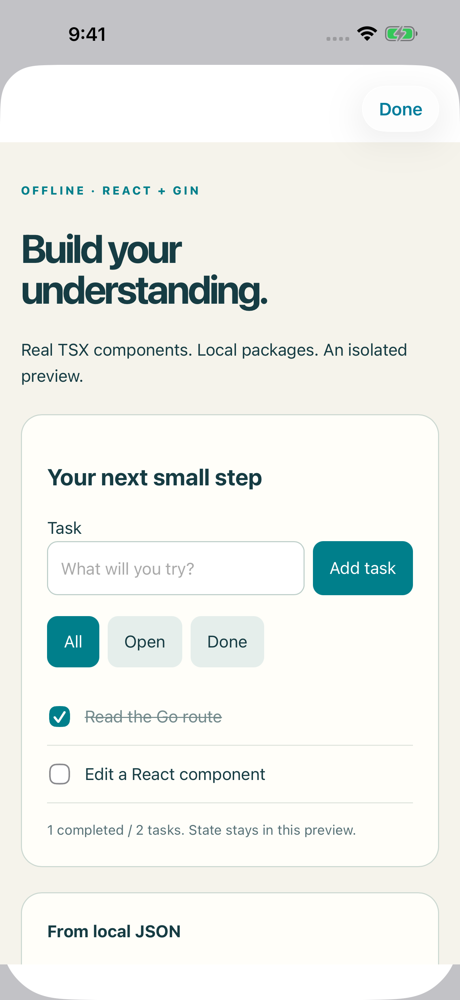

# Offline React frontend: educational mode

The **1.3.0 beta** adds this educational mode. It is a
local browser build tool, not an installation of Node.js/npm for iOS.
The project stays on device. No cloud build or package registry is used at runtime.



[Embedded Output preview](examples/offline-frontend/output.png).

## Try the study board

1. Open Examples → Offline frontend → **React + Gin study board**.
2. Open the example in the workspace and select Terminal.
3. Run `frontend packages` to inspect the bundled versions.
4. Run `npm install --offline`, then `npm run build`.
5. Select Output and open the isolated preview, optionally full screen.
6. Add a task, toggle completion and switch filters. The topic list comes from
   the project's local `web/api/summary.json` fixture.
7. Edit `web/src/model.ts`, `TaskRow.tsx`, `main.tsx` or `style.css`; rebuild.

Source changes invalidate the old preview. They do not silently present old
generated JavaScript as current. Source, the offline lock and generated output
are autosaved with the project. Browser state is temporary; it is not the project's saved learning progress.
The Go API session is shared between embedded and full-screen previews and
resets when you rebuild or reopen the project.

## Preview controls (native build 48)

Output now offers **Build & Preview** whenever an offline recipe is present but
its generated assets are missing or stale. It runs the same bounded
`frontend install` → `frontend build` operations as Terminal and displays a build
failure in Output. A successful Go Run no longer hides the frontend setup.
This shortcut does not execute project package scripts or download packages.

The embedded viewer offers **Open full screen**, **Reload**, and **Share / Open**.
An isolated frontend has no externally usable URL: its custom origin belongs to
the app's WebKit configuration and its network restrictions remain installed.
Use **Share project…** to send the `.tar.gz` snapshot; the recipient can import
and build it in GopherForge. Preview browser state is not included in that archive.

For legacy static sites, **Open in Browser** and **Share local address** use the
actual loopback address, not the port printed by a Gin route exercise. The link
works only on the device running the preview, while iOS permits the app to run;
it is not a published website or a link another device can open. **Share
project…** remains available for sending the actual files. No upload occurs
when a preview opens.

## Commands

| Command | Meaning |
| --- | --- |
| `frontend packages` | List the fixed bundled browser catalog |
| `frontend install` | Validate package requests and write the offline lock |
| `npm install --offline` | Same educational install |
| `npm ci --offline` | Require the existing lock to match |
| `frontend build` | Bundle from the declarative recipe inside WASI |
| `npm run build` | Build only when the package script is `gopherforge build` |
| `frontend preview` | Check freshness and expose the preview in Output |
| `npm run preview` | Preview only when the package script is `gopherforge preview` |
| `npm --version` | Explain this compatibility mode; no invented runtime version |

There is no general shell, lifecycle hook execution or subprocess support.
Other npm commands report that the full runtime is unavailable.

## Project files

`package.json`:

```json
{
  "private": true,
  "scripts": {
    "build": "gopherforge build",
    "preview": "gopherforge preview"
  },
  "dependencies": {"react": "19.3.1", "react-dom": "19.3.1"}
}
```

`gopherforge.frontend.json` is data, never executable configuration:

```json
{
  "entry": "web/src/main.tsx",
  "html": "web/index.html",
  "output": "web/dist",
  "minify": true
}
```

The HTML template needs `<!-- gopherforge:assets -->` where the generated
stylesheet and module script should be inserted. Source paths must be relative,
stay inside the project, and remain outside a separate `dist` output directory.
Existing output directories without the builder's stamp are preserved by
refusing the build. A successful build replaces only its own output directory.
Failed builds leave the original project unchanged.

The app writes `gopherforge.frontend.lock.json`. It is its own offline format,
not `package-lock.json` or a claim of npm solver compatibility.
Exact versions, `*`, and simple three-component `^` / `~` ranges are accepted
against the fixed catalog. Git URLs, registry tags and missing packages fail
without attempting a download. React DOM also requires the pinned React and
scheduler packages.

## What works

- Browser JS, JSX, TS and TSX through bundled esbuild 0.28.2 WASI.
- Bundled React / React DOM 19.3.1 and scheduler 0.28.0.
- Multiple local components and modules, hooks, reducers, forms, lazy imports
  bundled into the output, CSS, JSON and inline SVG/text imports.
- Relative imports and generated browser assets; local JSON fixture requests.
- Existing Go commands for the Go part of the project.
- Explicit local API paths backed by real Go handlers in the `gin-replay` mode below.

TypeScript is transpiled without a type checker. Unsupported Node built-ins
fail. Full npm, Node server code, Vite configuration/plugins, native addons,
arbitrary package scripts and automatic installation of new packages are absent.
Importing a complex React project may require adapting its dependencies and
build configuration to these limits.

## Isolation and budgets

The compiler sees a fresh WASI job tree containing project sources and selected
bundled package sources. Its virtual root is this temporary tree, never the
device root. No guest sockets, shell, child process or project plugin is exposed.
The compiler parses source; it does not run package scripts or frontend code.

Generated browser code runs in a nonpersistent WebKit store. A custom scheme
serves only this project's generated files and local JSON fixtures. No TCP
listener is opened. Content rules, CSP and navigation policy block external
HTTP(S), WebSockets, frames, workers, file URLs and popups. The app does not
forward arbitrary requests to Go handlers: only explicitly configured local API
paths enter the bounded Go bridge described below.

| Resource | Limit |
| --- | --- |
| Source project | 2,000 files / 32 MiB UTF-8 |
| Generated output | 100 files / 8 MiB UTF-8 |
| Compiler WASI linear memory | 384 MiB |
| Compiler WASI table | 65,536 elements |
| Captured compiler stdout / stderr | 1 MiB each |
| package.json / recipe | 256 KiB / 16 KiB |

These compiler limits do not change existing Go guest memory or module-download
budgets. Simulator results do not establish physical-device memory, thermal or
battery behavior.

## Optional local Go API

The default study board uses JSON fixtures. For a small deterministic Go API,
explicitly configure the educational Gin-compatible adapter with local prefixes:

```json
{
  "entry": "web/src/main.tsx",
  "html": "web/index.html",
  "output": "web/dist",
  "minify": true,
  "backend": "gin-replay",
  "backendPaths": ["/api/items"]
}
```

Calls such as `fetch('/api/items')` then execute the actual Go handlers through
`httptest`. The app's Gin-compatible subset supports GET, POST, PUT, PATCH,
DELETE, named path parameters, JSON binding and JSON responses. It is not the
full upstream Gin library. Import compatible project sources and review the
recipe and build adaptations; there is no automatic Vite or CRA conversion.

An external interoperability check used
[jbenassi/react-go-gin](https://github.com/jbenassi/react-go-gin) at commit
`08418534efed1b32290ac3b1eb1db296c4bd34ae`. Original React `App.js` and Go
`server/main.go` remained unchanged while build files were adapted. The check
covered initial read, create, update and delete against real Go handlers.
**This external project is not included in the app, Examples or release bundle.**
To reproduce the optional developer test, run
`python3 scripts/prepare_github_frontend_check.py`, then `OfflineGitHubTests`.
The checkout, its licence and the test input stay under ignored `build/`.

### How the Go API stays offline

There is no listener, socket or external server. A document-start fetch bridge
accepts only same-project, main-frame requests to allowlisted paths. A fresh
WASI invocation runs the actual Go handlers using `httptest`. A bounded mutation
log is replayed first, reconstructing the in-memory teaching API state, then the
new request runs. Linked Go artifacts are cached; request bodies are runtime
inputs, not cache identity. Both preview sizes share this API session.

This mode suits deterministic, small, in-memory learning APIs. Randomness, time,
external services, background workers, streaming, databases and persistent
transactions do not have general server semantics here. GET handlers should be
read-only. Responses and history are temporary; save durable project data in
the project files instead. Rebuild or reopen the project to reset the session.
No project source or frontend code receives a host-network capability.

| API resource | Limit |
| --- | --- |
| Configured path prefixes | 1–16 |
| Methods | GET, POST, PUT, PATCH, DELETE |
| Request body | 32 KiB |
| Request headers | 32; keys 128 bytes, values 2 KiB; no CR/LF |
| Path | 4 KiB; no traversal or absolute URL |
| Mutations per session | 64; later reads remain available |
| Encoded request history | 2 MiB |
| Response body | 256 KiB |

Unsupported requests fail with an explanation. The usual Go guest memory and
output budgets still apply. The app does not download npm packages at runtime.
The initial import of an arbitrary GitHub project needs a connection; the
bundled example, its package sources, build, API and preview do not.

## Verification

The focused native and WebKit tests exercise the actual bundled WASI tools,
React form events and Go GET/create/update/delete handlers. They check the
upstream source hashes, shared preview state and rejection of external fetches
and invalid bridge paths. The release QA record links the results and native
screenshots. Physical-device memory, thermal and battery behaviour remain
separate from simulator verification.

Earlier records: [npm-only check](examples/offline-frontend/npm-only-check-2026-10-27.json)
and [initial prototype](examples/offline-frontend/check-2026-10-27.json).
